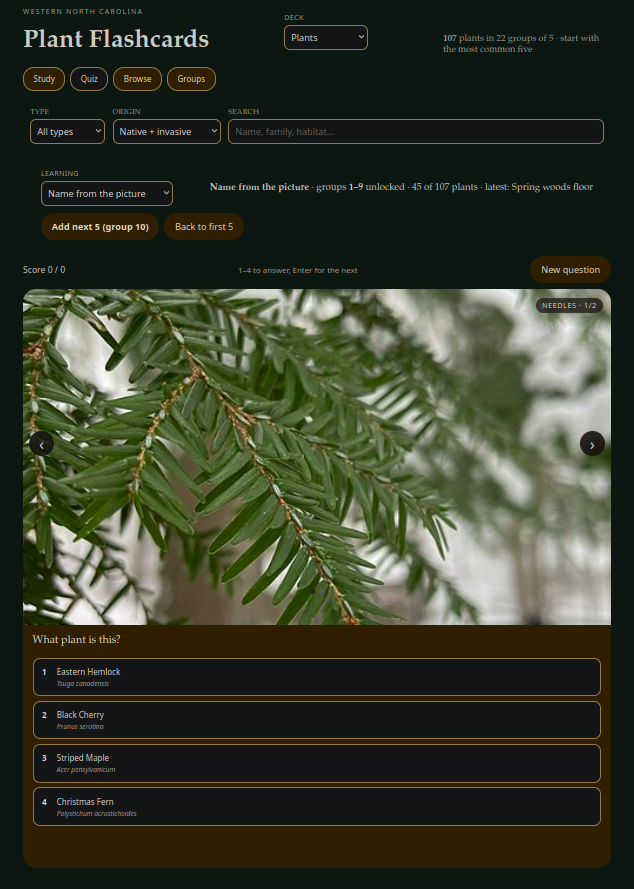
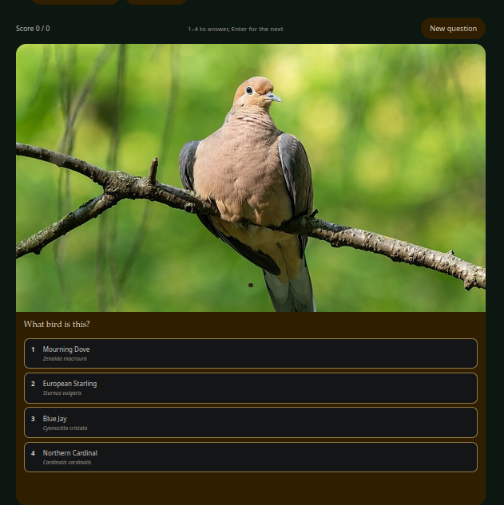

# WNC Plant and Bird Flashcards

A local Python flashcard app for trees and plants of **Western North Carolina**, plus the birds you are likely to meet in North Carolina. Plants include common natives, mountain specialties, useful species, and the main invasives. Birds include natives and the introduced species that now live here.

## What you get

- **Study mode:** a photo first. Flip the card for the name, identification, habitat, and uses.
- **Quiz mode:** four choices. Pick what you are learning from the menu: name from the picture, uses, look-alikes, or how to identify it. Each topic keeps its own groups, so name-from-picture can be on group 9 while uses is still on the first five.
- **Birds:** switch the deck to Birds. The same study, quiz, browse, and group tools are there, with voice and diet in place of plant uses.
- **Bird calls:** Name from the call plays the song, then you match it to a picture and the bird's name. Play call is also on the study card. Clips live in `sounds/`.
- **Progress:** the Progress tab graphs quiz accuracy as you answer, by topic for plants and birds, plus the cards you have marked "I knew it."
- **Browse:** the unlocked deck as a field-guide grid.





Photos are Wikipedia / Wikimedia Commons images, saved in this folder so the app works offline after the first fetch. Some bird songs were saved the same way. Others were added locally with `extract-audio.sh`.

## Run it

```bash
cd ~/wnc-plants
python3 app.py
```

Then open [http://127.0.0.1:5055](http://127.0.0.1:5055).

Needs Python 3 and Flask (`pip install -r requirements.txt`). `python3 download_images.py` fetches plant photos. `python3 download_birds.py` fetches bird photos. `python3 download_bird_calls.py` fetches calls from Wikimedia until the first rate limit.

## What is in the decks

Western NC has more than 2,000 vascular plants. The plant deck is not every species. It is the set you actually need in order to start knowing the mountains:

- Canopy and understory **trees** of coves, ridges, and spruce-fir peaks
- Signature **shrubs** (rhododendron, mountain laurel, flame azalea, spicebush)
- Common **vines**, **wildflowers**, and **ferns**
- The **invasives** on NC Forest Service / NC-IPC lists (kudzu, stiltgrass, tree-of-heaven, and so on)
- Useful species (pawpaw, ramps, sourwood, ginseng) with honest cautions

The bird deck is 95 common North Carolina birds in groups of five, familiar yard birds first. It mixes natives with introduced birds such as the house sparrow, European starling, Eurasian collared-dove, and rock pigeon. It is not the full state list.

Facts were checked against NC Cooperative Extension, the NC Native Plant Society, NC Forest Service invasive lists, and standard field knowledge. Traditional uses are historical. They are **not** medical advice, and they are not a foraging go-ahead. Never eat a plant unless you are sure of the ID and of which part is actually edible. Native birds are protected. Leave nests alone.

## Files

- `data/seed_plants.py` — curated plant notes
- `data/plants.json` — plant deck
- `data/seed_birds.py` — curated bird notes
- `data/birds.json` — bird deck, including which calls are saved
- `images/` — local photos
- `sounds/` — bird calls
- `app.py` — Flask app
- `download_images.py` — plant photo fetch
- `download_birds.py` — bird photo fetch
- `download_bird_calls.py` — Wikimedia call fetch
- `extract-audio.sh` — save an MP3 from a link or a video you already have
- `readme/` — screenshots used above
